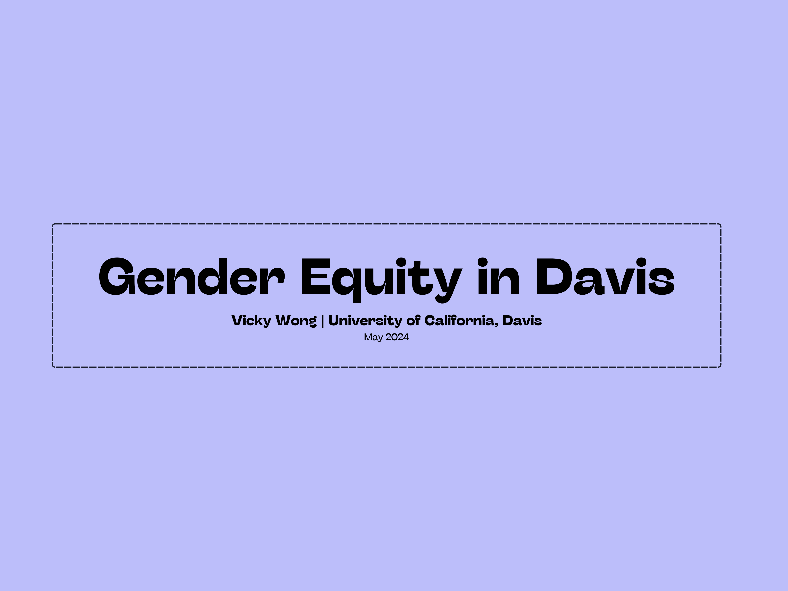
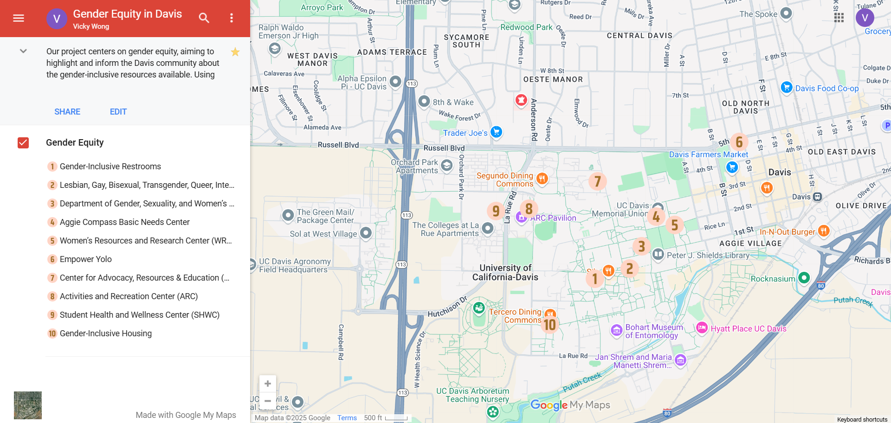

  <h1>♀️ Gender Equity in Davis, California, United States</h1>

  

    A community asset map highlighting gender-inclusive
    resources and services in Davis, California.
  

<h2>📑 Table of Contents</h2>

<ul>
  <li><a href="#objective">Objective</a></li>
  <li><a href="#project-details">Project Details</a></li>
  <li><a href="#poster">Poster</a></li>
  <li><a href="#map">Map</a></li>
  <li><a href="#images">Images</a></li>
</ul>

<h2 id="objective">🎯 Objective</h2>

  This project focuses on promoting gender equity within
  the Davis community by highlighting and informing
  individuals about the gender-inclusive resources
  available. Utilizing the principles of Asset-Based
  Community Development (ABCD), a comprehensive
  community asset map was created that identifies
  and showcases essential locations supporting
  gender inclusivity.

<h2 id="project-details">🛠️ Project Details</h2>

  <strong>Tools:</strong> Google Maps, Canva

<strong>Format:</strong> Poster, Map

<h2 id="poster">🖼️ Poster</h2>

  <a href="https://github.com/redefiningvicky/Gender-Equity-in-Davis/blob/main/Poster/Gender_Equity_in_Davis_RGB.pdf">
    View Poster RGB
  </a>
  &nbsp; • &nbsp;
  <a href="https://github.com/redefiningvicky/Gender-Equity-in-Davis/blob/main/Poster/Gender_Equity_in_Davis_CMYK.pdf">
    View Poster CMYK
  </a>

<h2 id="map">🧭 Map</h2>

  <a href="https://www.google.com/maps/d/u/2/viewer?mid=1JCHQmCF28HG8ACYw9BgTf9y4J9lAowo&amp;ll=38.5426388946742%2C-121.75602006538955&amp;z=15">
    View Map
  </a>

<h2 id="images">🖼️ Images</h2>

<h3>Gender Equity in Davis — Poster 1</h3>

<table>
  <tr>
    <td>
      
    </td>
  </tr>
</table>

<h3>Gender Equity in Davis — Poster 2</h3>

<table>
  <tr>
    <td>
      
    </td>
  </tr>
</table>

<h3>Gender Equity in Davis — Poster 3</h3>

<table>
  <tr>
    <td>
      
    </td>
  </tr>
</table>

<h3>Gender Equity in Davis — Community Asset Map</h3>

<table>
  <tr>
    <td>
      
    </td>
  </tr>
</table>

  

    <a href="https://github.com/redefiningvicky/Technical-Projects">
      Back to Technical Projects
    </a>
    &nbsp; • &nbsp;
    <a href="https://github.com/redefiningvicky/redefiningvicky">
      Back to Portfolio
    </a>
  

